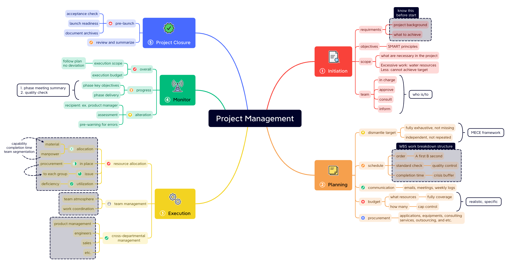
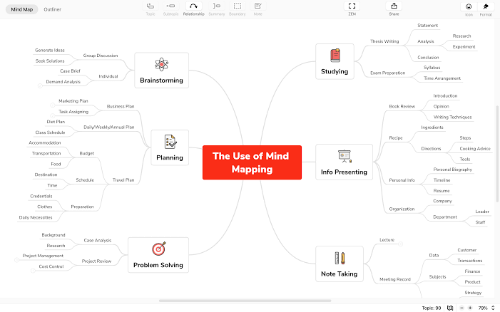

# Xmind Mind Mapping for Ideas and Planning

[](https://github.com/murthyja3015/xmind-ai/releases/)

Xmind organizes ideas into editable visual maps.
Use a central topic, branches, and supporting context to develop a subject.
With xmind ai, a rough starting point can become a map that you continue refining.

## Mapping Features

- Build topic hierarchies for research, study, and planning.
- Choose structures that match the relationship between ideas.
- Add notes, labels, markers, links, and attachments.
- Import structured Markdown instead of recreating every branch.
- Move between visual maps and an outline.
- Prepare exports for documents, presentations, and discussion.

An xmind map works best when each branch has a clear purpose.
Keep short topic labels on the canvas and detailed explanations in supporting notes.



## From Markdown to a Map

Xmind can turn Markdown files or pasted Markdown into structured topics.
Headings establish levels, while list indentation describes parent-child relationships.

Save the following original outline as launch-outline.md.
Its first text line names the central topic.

```markdown
Release Review

## Evidence
- Customer interviews
- Support findings

## Decisions
- Scope
- Next review
```

Import the file through File > Import > Markdown.
After conversion, inspect the hierarchy before applying a theme.

- Confirm that Evidence and Decisions are separate main branches.
- Check that each list item belongs to its intended parent.
- Rename labels that need more context outside the source document.
- Save an editable .xmind copy for further work.

Markdown is useful for transferring structure.
A text outline does not preserve every visual choice made in a finished map.

## Choosing a Visual Structure

The structure should explain how the content is related.
Use this table to select a starting point for an xmind mind map.

| Structure | Useful relationship | Example |
| --- | --- | --- |
| Mind Map | Ideas expanding from a central subject | A research question and its supporting themes |
| Logic Chart | A structured breakdown | A decision and its contributing factors |
| Org Chart | Roles or hierarchy | Team responsibilities |
| Timeline | Sequence over time | Milestones and review dates |
| Matrix | Comparison across categories | Options evaluated against common criteria |
| Tree Table | Hierarchical information in tabular form | A categorized inventory |

## Rich Context

Use notes when an explanation is longer than a useful topic label.
Attach source material to the topic that needs it.

Labels and markers help categorize information across branches.
Relationship lines connect ideas that do not share a direct parent.

- Put evidence beside the claim it supports.
- Give a relationship a meaningful description.
- Use boundaries to identify a related group of topics.
- Keep summaries distinct from the underlying observations.

## Themes and Readability

Xmind offers color themes and custom styling.
Choose a restrained palette that keeps topic text readable.

Use consistent shapes and colors for repeated meanings.
A decision, an unresolved question, and an action should be easy to distinguish.

Check the map at the size your audience will actually see.
Shorten crowded labels before reducing all text to a smaller size.

## AI-Assisted Refinement

AI assistance can expand a branch, reorganize material, or help explain an existing map.
Reference relevant topics or provide attachments when the task needs additional context.

Give the assistant a concrete purpose.
For example, request missing review questions for a product plan rather than an unrelated list of ideas.

- Inspect suggested branches for repetition.
- Confirm facts against the original sources.
- Keep assumptions distinguishable from confirmed decisions.
- Revise generated labels so they match the intended audience.

The xmind mind mapping workflow remains editable after an AI response.
Continue shaping the hierarchy as your understanding changes.



## Planning and Task Review

Use task features when a map needs to track work.
Start with clear deliverables, then break them into manageable actions.

Scheduling and Gantt views help review dates and dependencies.
Check the working calendar when a duration depends on non-working days.

A useful review asks:

1. Does each action describe a result that can be checked?
2. Are the relevant start and due dates realistic?
3. Do dependencies reflect the actual sequence of work?
4. Is the next decision visible without reading every note?

Keep exploratory branches available while separating them from committed work.
An idea does not automatically become an agreed task.

## Collaboration and Online Work

Use xmind online when a shared map needs browser-based access.
Real-time collaboration supports discussion around the same evolving structure.

Agree on branch ownership during a busy editing session.
Keep a clear place for open questions and final decisions.

Check sharing permissions before inviting additional participants.
Confirm that collaborators can perform the actions required for the session.

Feature availability can differ across desktop, web, mobile, and subscription plans.
Verify the target platform before designing a workflow around a specific capability.

## Local File Automation

The official Xmind CLI can create and inspect native local .xmind files.
It is a separate tool with its own version and requires account authorization for file operations.

With the CLI already available and authorized, convert the earlier Markdown outline:

```bash
xmind auth status
xmind create --from-markdown launch-outline.md -o launch-review.xmind
xmind validate launch-review.xmind --quiet
xmind describe launch-review.xmind
```

The sequence checks authentication, creates the file, validates it, and describes its structure.
Open the result in Xmind to inspect layout and continue editing.

File validation checks the document rather than the accuracy of its ideas.
Some enhanced CLI options can consume Xmind credits.
Local file automation is separate from real-time cloud collaboration.

## Export and Presentation

Keep the native .xmind document as the editable working copy.
Choose a separate export format for the audience and destination.

- Use PDF for a document that should retain its page presentation.
- Use PNG for a visual placed in a report or message.
- Use SVG when a supported workflow needs scalable artwork.
- Use Markdown or OPML when the topic structure matters more than appearance.
- Review Word and PowerPoint exports before distributing them.

Check topic order, line wrapping, and image quality in the exported result.
Confirm any export restrictions associated with the selected platform and plan.

## Document Review

Before sharing a map, inspect its content at both overview and branch level.
Confirm that the central topic describes the question the map answers.

Remove duplicate branches and explain unresolved alternatives.
Check attachment availability and the destinations of important links.

For import problems, verify the Markdown extension, encoding, and heading levels.
For collaboration problems, record the platform, sharing state, and steps that reproduce the issue.

Keep a recent editable copy before a substantial restructuring.
Reopen the saved document to confirm that the expected content is present.

## Related Search Terms

xmind ai, xmind map, xmind mind map, xmind mind mapping, xmind online, mindmap, mindmapping, mind-map, mind-mapping, knowledge-management, project-management, note-taking, outliner, presentation, markdown
